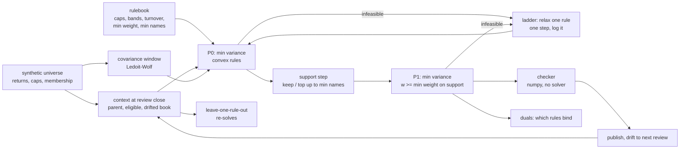

# constrained-index-rebalancer

[](https://github.com/Avinash186200/constrained-index-rebalancer/actions/workflows/ci.yml)
[](LICENSE)


A quarterly rebuild of a minimum-volatility index under benchmark-relative rules. cvxpy minimises variance with a shrunk covariance. Turnover is measured against the drifted holdings. When the rules cannot all hold, a logged ladder relaxes them in a fixed order. A separate checker re-tests every published book without trusting the solver. Dual values and leave-one-rule-out solves show which rules bind and what each one costs in volatility.

## Scenario

An index team runs a minimum-volatility version of a broad parent equity index. Each quarter it must rebuild the index from the parent under the index rules: sector and country weights within bands around the parent's, a cap on each stock tied to its parent weight, a minimum holding weight, a minimum number of names, and a turnover limit against the holdings as they have drifted since the last rebalance. It has to publish weights that meet every rule and show that they do. When the rules conflict, it has to say which rule it relaxed and by how much.

This is a scenario to frame the work. All data is synthetic, generated in this repo, and the rule values are illustrative. They are not any index provider's methodology.

## What it does

| part | what I built | how it is checked |
|---|---|---|
| universe | 500 stocks, 11 sectors, 6 countries, 13 years of daily factor-model returns (market, sector, country, size, specific) with stochastic volatility; cap-weighted parent; late listings and leavers; planted crises, a sector boom and two parent reconstitutions | determinism, membership and point-in-time tests |
| risk | Ledoit-Wolf shrinkage towards a scaled identity, passed to the solver in factor form so the objective holds no N x N matrix | matches a term-by-term implementation of the formula |
| optimiser | minimum variance in cvxpy (CLARABEL, pinned): caps, sector and country bands, turnover against drifted holdings (convex `abs`), then a support step for the minimum-weight and minimum-names rules | SLSQP cross-check on a small problem; sector, country and turnover duals match finite differences |
| relaxation | fixed-order ladder: turnover, then country band, then sector band, then minimum names; each rung logged with the stage that failed; raises if the ladder runs out | property tests: published books pass, or every rung is used |
| checker | numpy re-test of every rule with an absolute tolerance of 1e-7, against the effective and the original rulebook | each kind of violation is caught; tolerance edges |
| backtest | 44 quarterly reviews vs the parent and an unconstrained minimum-variance book; development reviews 8-31, held-out 32-51 | every committed book re-verified; a subset of reviews re-solved from scratch in CI |

## How it works



The covariance window and the shrinkage are chosen on development reviews 8-31 and frozen. Reviews 32-51 are held out, with three disclosed exceptions: held-out reviews were seen in a prototype and in a first full run before the tie rule was fixed (see Results and [docs/methodology.md](docs/methodology.md)). Every solve reads only data known at the review's close. A test replaces every return after the close with noise and checks that the published weights do not change.

## Results

All numbers come from synthetic data, copied from [results/RESULTS.md](results/RESULTS.md). `make bench` rebuilds that file from scratch. There is one universe and one path, so the tables have no standard errors. Read differences of a few tenths of a vol point as ties.

**Development choice.** All six window and shrinkage settings land within 0.20 vol points of each other (12.85% to 13.05% realised). The two 504-day settings tie at 12.85%, and the tie rule picks Ledoit-Wolf. The choice barely matters here.

**Held out, with three disclosed exceptions.** Held-out reviews were seen before the final run: a prototype led me to raise `min_names` from 100 to 120 and to add a round-up retry to the support step, and a first full run picked 504 days without shrinkage before I added the tie rule. `make bench` measures all three (the sensitivity table in [results/RESULTS.md](results/RESULTS.md)). Re-running the first run's choice gives the same held-out vol, 12.397%. `min_names = 100` gives 12.395%. The round-up retry fired in 0 of 44 reviews. Details: [docs/methodology.md](docs/methodology.md).

**Held-out reviews 32-51 (5 years, 1,259 days):**

| book | ann. vol | vol reduction vs parent | tracking error vs parent | beta | max drawdown | mean one-way turnover per review | mean names | max abs sector dev (pp) | realized / ex-ante vol |
|---|---|---|---|---|---|---|---|---|---|
| parent | 18.02% | - | - | 1.00 | -28.6% | - | - | - | - |
| **rule-constrained index** | **12.40%** | **31.2%** | 7.43% | 0.65 | -19.2% | 10.4% | 120 | 5.00 | 1.05 |
| unconstrained min variance | 11.68% | 35.2% | 9.98% | 0.56 | -22.4% | 21.1% | 62 | 19.85 | 1.12 |

Development reviews 8-31 tell the same story: index 12.85% against parent 18.26% (29.6% reduction), unconstrained 12.35%.

**Rules over the held-out reviews:**

| rule family | share of reviews binding | mean ex-ante vol cost if removed (vol points) |
|---|---|---|
| stock caps | 100% | 0.433 |
| sector bands | 100% | 0.127 |
| country bands | 100% | 0.017 |
| turnover limit | 90% | 0.006 |
| min weight + min names | 95% (floor binds); top-up needed in 17 of 20 reviews | 0.001 |
| all rules at once | | 1.399 |

- **Checker:** 44 of 44 published books pass every rule. Against the original rulebook, the only miss is turnover at review 42. There the ladder relaxed the limit from 10% to 20% in two logged rungs, because a planted reconstitution removed 8% of the parent's names and those holdings had to be sold.
- **The index keeps most of the volatility reduction.** It gives up 0.72 vol points against unconstrained minimum variance (12.40% against 11.68%). In return it holds sector and country weights within 5 points of the parent (the unconstrained book drifts up to 19.85 points away), cuts tracking error from 9.98% to 7.43%, and halves turnover.
- **Stock caps are the costly rule.** They bind at every review (about 80 of 120 held names sit at their cap) and cost 0.43 vol points on their own. Sector bands cost more in the held-out period (0.127) than in development (0.011). The cost rises with the parent's largest sector, which grew to about a quarter of the parent from review 31 and fell back after the reconstitution at review 42. It is not the planted boom: during the boom, that sector only rose from 6.7% to 7.9% of the parent. Country bands, turnover and the holding rules each cost 0.017 points or less.
- **Rule costs do not add up.** Removed one at a time, the five costs sum to 0.584 points. Removed together they cost 1.399. Rules overlap: without the caps, the bands still spread the book out. Ex-ante cost also overstates what is realised: the all-rules gap is 1.40 points ex ante but 0.72 points realised.
- **The turnover limit is cheap here.** In the sweep, held-out volatility is 12.40% to 12.41% for limits of 5%, 10%, 20% and none. At 5% the ladder had to relax 3 reviews in each period.
- **The risk model under-forecasts.** Realised over mean ex-ante volatility is 1.05 for the index and 1.12 for the unconstrained book. The more concentrated unconstrained book is likely leaning harder on estimation error; I did not test why.

## Key concepts

- **Benchmark-relative constraints.** Caps and bands are written around the parent's weights at the review, so they move with the parent. A sector that rallies in the parent drags the index's lower band up with it.
- **Turnover against drifted holdings.** The "before" book is last quarter's weights grown with realised returns (share counts at today's prices), not the published weights. Names that left the parent must be sold in full, and that sale counts against the limit.
- **Convex where possible, honest where not.** Caps, bands, turnover, budget and long-only are convex. Minimum weight and minimum names are not ("zero or at least x"). A support step fixes which names are held, and a second convex solve applies the floors. The support is a heuristic, not the optimum of the mixed-integer problem.
- **Relaxation ladder.** When the rules conflict, the first rule in a fixed order that can still move is relaxed by one step, and the whole rebalance is retried. Every rung is logged, and the run raises if the ladder runs out.
- **Duals and binding.** A constraint binds when it sits at its bound with a positive dual value. A family's summed dual value is the first-order variance saving from loosening all its bounds by one point. It is good for ranking rules and for small changes. For removing a rule entirely, the leave-one-rule-out re-solve is the real number.
- **Independent verification.** The checker never imports the solver. It recomputes every constrained quantity from the published weights, so a modelling bug in the optimiser shows up as a failed check, not as a quietly wrong index.

## Quick start

```bash
pip install -c constraints.txt -e ".[dev]"   # exact versions the results were made with
pytest -q                                     # unit + property tests, results re-verified, a subset re-solved
make demo                                     # build at review 8, rebalance at review 9, binding and costs printed
make bench                                    # full rerun (several minutes): results/*.json and RESULTS.md
make verify                                   # recompute all of runs.json and compare
```

[docs/walkthrough.md](docs/walkthrough.md) walks through the demo output and shows how to run a rebalance on your own data. [docs/rulebook.md](docs/rulebook.md) goes rule by rule from a methodology sentence to a cvxpy line and a checker test.

## Layout

```
src/ixrebal/
  universe.py    synthetic universe, parent index, membership calendar, planted events
  risk.py        sample / Ledoit-Wolf covariance in factor form
  rules.py       rulebook, ladder, per-review bounds
  optimizer.py   P0, support step, P1, ladder, duals and binding, unconstrained book
  checker.py     independent numpy verification
  backtest.py    point-in-time contexts, drift, review records, leave-one-rule-out
  metrics.py     return, vol, tracking error, beta, drawdown
  bench.py       development choice, held-out run, sweep, summaries, RESULTS.md
  cli.py         ixrebal bench | report | demo
tests/           unit, property-based (hypothesis), look-ahead, results re-verification
results/         runs.json (every review record), summaries, RESULTS.md
docs/            methodology, walkthrough, reading a rulebook into constraints
```

## Limitations

- **One synthetic universe, one path.** The factor model is clean: no fat-tailed jumps, no style factors beyond size, no low-volatility anomaly (expected returns do not depend on risk). Returns are therefore not evidence of anything. The return differences in the tables (for example 3.35% against 4.53% held-out) are one draw. Only the risk, tracking and rule statistics are meant to be read.
- **The planted events are mine.** The crises, the sector boom and the two reconstitutions were added to stress the rules. The sector boom barely moved the parent (that sector went from 6.7% to 7.9% of it), so it did not stress the sector bands as intended. The only ladder event in the main run comes from a planted reconstitution. A real index would see different conflicts, for example a sector band that cannot be met because the sector's eligible names are capped.
- **The support step is a heuristic.** It keeps names that P0 holds and tops up to the minimum count by P0 weight, then by own variance. A mixed-integer solver could find a lower-variance book with a different set of names. The leave-one-rule-out cost of the holding rules (0.001 points) is measured against this heuristic, not against the true optimum. For the same reason, removing the turnover rule raised ex-ante volatility in 6 of 44 reviews (by at most 0.0004 points).
- **The ladder is fixed-order.** It relaxes the first rule that can still move, not the rule actually in conflict. In the unit tests it relaxes turnover and country bands on the way to a sector conflict. An elastic formulation that minimises the weighted relaxation in one solve would be better and is not built.
- **Rule costs are ex ante.** They come from re-solving each review's state with one rule removed, using the same covariance and that review's effective (possibly relaxed) rulebook. They are not separate backtests, and the realised gap is smaller (1.40 points ex ante against 0.72 points realised for all rules together).
- **Dual values need care.** The first-order number for stock caps (about 39 (vol %)^2 per point) extrapolates a move of one point on every one of about 120 caps. It overstates what removing caps actually saves. The tests check the duals against finite differences only for small moves.
- **The risk model is simple.** Sample or Ledoit-Wolf towards a scaled identity, with no factor risk model and no volatility forecasting. It under-forecasts realised volatility: realized / ex-ante is 1.05 to 1.15 across periods and books. The development choice between six settings was a near-tie.
- **Not modelled:** trading costs and market impact, cash and dividends, corporate actions beyond joins and leaves, identifier changes, rounding to share lots, a cross-check against an index provider's published weights, and solve time at scale (not benchmarked).
- **Cross-platform reproducibility is tested to a tolerance, not bit for bit.** CI on Linux re-solves a subset of reviews and compares with the committed Windows results to 1e-6 absolute. It does not re-run the whole benchmark (`make verify` does).

## License

MIT. See [LICENSE](LICENSE).
